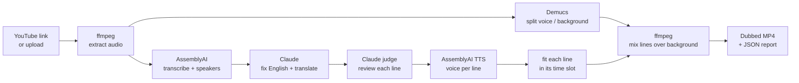

# Dubla

Dubs English jiu-jitsu videos into Brazilian Portuguese. Paste a YouTube link or upload a video, get the same video back with a Portuguese voice that starts on the original speaker's timing, over the original background sound.

I built it because the best jiu-jitsu instructionals are in English and YouTube's auto-translation either doesn't cover them or gets the technique wrong. The dub uses mat vocabulary from Brazil ("raspar", "passar a guarda", "pegar as costas"), not a literal translation.

## How it works



`IngestionService.dublar` runs the pipeline:

1. **Download (optional).** yt-dlp fetches the video (H.264, up to 720p) when a link is given.
2. **Extract audio.** ffmpeg pulls an MP3 out of the video.
3. **Split voice and background.** Demucs (`htdemucs`, two stems) runs locally and keeps the music and ambient sound for the final mix.
4. **Transcribe.** AssemblyAI returns words with timestamps and speaker labels, helped by a list of ~100 BJJ terms. The words are cut into lines: one speaker each, split at sentence ends or pauses once a line has at least 1.5 s, always split on a speaker change, a pause of 1.5 s or more, or at ~12 s.
5. **Translate.** One Claude call sees the whole video, fixes transcription mistakes in the English ("judo gatame" → "juji gatame") and translates each line with a character budget based on its duration.
6. **Judge.** A second Claude prompt reviews every line (BJJ terms, natural spoken Portuguese, meaning, length). Rejected lines go back to the translator with the reason, at most twice.
7. **Voice.** AssemblyAI TTS reads each line. The person who talks the most gets `aai-cassio`, the second `aai-benicio`; from a third speaker on, the two voices alternate. Requests are paced to the account limit of 50 per minute, and the silence the TTS adds at both ends is trimmed.
8. **Fit.** Each line must start at its original time and end before the next one. If it is too long: speed up to 15% → run over the following silence → ask Claude to shorten it (up to 3 times) → cut it at the next line with a short fade. The video itself is never cut or slowed down.
9. **Mix.** ffmpeg delays each line to its original start and mixes them over the background. The video stream is copied untouched and the output keeps the original duration.

A JSON report per video goes to `relatorios/` at the repo root: speaker, English, Portuguese, judge verdict, original vs. dubbed start, and whether the line was shortened, sped up or cut.

## Stack

| | |
| --- | --- |
| Backend | NestJS 11 · TypeScript · fluent-ffmpeg · Multer |
| AI | AssemblyAI (transcription, TTS) · Claude (translation, judge) |
| Local tools | Demucs (PyTorch, CUDA if available) · yt-dlp |
| Frontend | React 19 · Vite · Tailwind CSS v4 |
| Tooling | pnpm workspaces · Jest · ESLint · Prettier |

## Run it locally

Requirements: Node.js 20+, pnpm, ffmpeg on your PATH, Python 3.12 and [uv](https://docs.astral.sh/uv/).

```bash
git clone https://github.com/gustavokurtz/dubla.git
cd dubla
pnpm install      # the repo pins pnpm 10.32.1 via "packageManager"
```

### Python tools

Demucs and yt-dlp are Python programs. The backend runs them as child processes (`python -m demucs`, `python -m yt_dlp`) from a virtualenv at `back/.venv-py`:

```bash
cd back
uv venv .venv-py --python 3.12
uv pip install --python .venv-py/bin/python -r requirements-python.txt \
  --extra-index-url https://download.pytorch.org/whl/cu128
cd ..
```

The `cu128` index gives a CUDA build of PyTorch. Demucs uses the GPU when one is available (an RTX 4050 splits a 5-minute video in ~15 s) and falls back to the CPU, which is much slower. To use a Python somewhere else, set `FERRAMENTAS_PYTHON` to its path.

### Keys

Create a `.env` file at the **repository root** (not inside `back/`):

```bash
ASSEMBLYAI_API_KEY=your-assemblyai-key
ANTHROPIC_API_KEY=your-anthropic-key
# FERRAMENTAS_PYTHON=/path/to/python   # optional, defaults to back/.venv-py/bin/python
```

### Start

```bash
pnpm dev          # backend on :3000, frontend on http://localhost:5173
```

Paste a YouTube link or drop a video and wait for the download. The frontend proxies `/api` to `localhost:3000`.

## Cost and time

Measured on a 4:45 instructional with one speaker (72 lines): about 4 minutes end to end and about US$0.42 (Claude ~US$0.35, AssemblyAI ~US$0.07). Both grow roughly with video length; the voice step is bound by the 50-requests-per-minute limit.

## API

`POST /ingestion/dublar` with `multipart/form-data`:

- `url`: a YouTube link, or
- `video`: a `video/*` file up to 100 MB

Returns the dubbed video as `video/mp4` (`video-dublado.mp4`). If both are sent, the link wins.

```bash
curl -F 'url=https://www.youtube.com/watch?v=...' http://localhost:3000/ingestion/dublar -o dublado.mp4
curl -F "video=@lesson.mp4" http://localhost:3000/ingestion/dublar -o dublado.mp4
```

## Project layout

```
back/                   NestJS API and pipeline
  src/ingestion/        orchestrator + endpoint
  src/youtube/          yt-dlp download
  src/separacao/        Demucs voice/background split
  src/transcricao/      AssemblyAI transcription + cutting into lines
  src/traducao/         Claude translator, judge and the BJJ guide (guia-bjj.ts)
  src/voz/              AssemblyAI TTS, one voice per speaker
  src/encaixe/          fitting each line in its time slot
  src/ffmpeg/           audio extraction, silence trim, final mix
  src/relatorio/        per-video JSON report
  scripts/              manual scripts (download, voice probe, no-cost rehearsal)
  requirements-python.txt
front/                  React UI (upload or link, progress, download)
```

## Limitations

- Runs locally only. Deploying needs a GPU host for Demucs (or a hosted Demucs) and YouTube often blocks downloads from cloud IPs.
- The whole video is translated in one Claude call, which caps it at roughly 35 minutes of speech.
- Two voices: with three or more speakers, voices repeat.
- The request stays open for the whole pipeline and nothing is resumable: a failure halfway loses the paid steps already done.
- The progress bar in the UI cycles through the steps; it does not track the real one.

## Tests

```bash
cd back && CI=true npx jest
```

The ffmpeg tests run the real ffmpeg binary.
